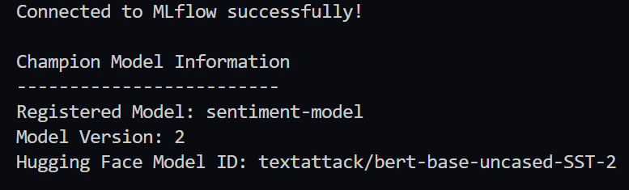
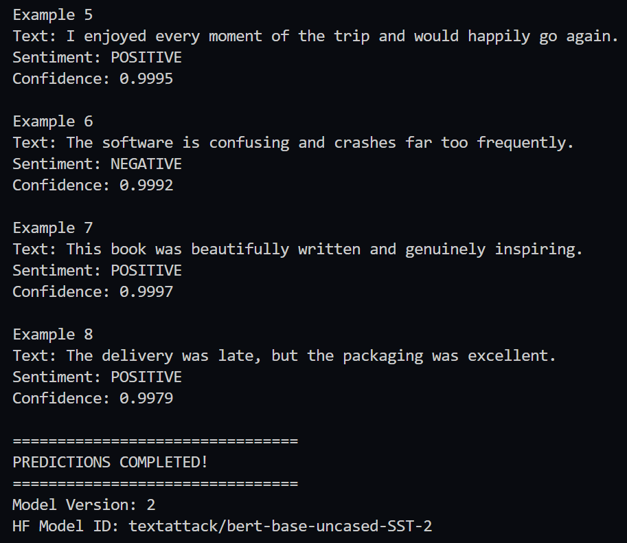

# Champion–Challenger Model Comparison with Hugging Face and MLflow

## 1. Project Overview

This project implements a Champion–Challenger MLOps workflow for sentiment classification using Hugging Face Transformers and MLflow.

Two pre-trained transformer models are evaluated on the same dataset. Their performance is compared using classification metrics and inference latency. Based on a predefined decision rule, the better-performing model is promoted as Champion.

**Student USN:** 1MS25CI147

**Task:** Sentiment Classification

**Dataset:** SST-2 (GLUE)

**Evaluation Samples:** 200

## 2. Models

| Model | Hugging Face Model ID | Initial Role |
|---|---|---|
| Model A | `distilbert-base-uncased-finetuned-sst-2-english` | Champion candidate |
| Model B | `textattack/bert-base-uncased-SST-2` | Challenger candidate |

## 3. Champion–Challenger Decision Rule

The primary evaluation metric is **Macro-F1**, where a higher value is better.

The Challenger (Model B) replaces the Champion (Model A) only if:

1. Its Macro-F1 score is at least 0.01 higher than Model A.
2. Its average inference latency does not exceed 5 times Model A's average inference latency.

This decision rule is defined before the final evaluation and is not changed after observing the results.

## 4. Dataset

- Dataset: SST-2 from GLUE
- Evaluation samples: 200
- Random seed: 42
- Input file: `data/eval_inputs.csv`

Both models are evaluated using exactly the same evaluation examples.

## 5. Experimental Results

| Metric | Model A | Model B |
|---|---:|---:|
| Accuracy | 0.9150 | 0.9500 |
| Macro-Precision | 0.9183 | 0.9505 |
| Macro-Recall | 0.9121 | 0.9491 |
| Macro-F1 | 0.9141 | 0.9497 |
| Average latency (ms) | 38.1082 | 77.4817 |
| Total inference time (s) | 7.6216 | 15.4963 |

## 6. Model Selection and Conclusion

Model B (`textattack/bert-base-uncased-SST-2`) was selected as the new Champion.

- Macro-F1 improvement: 0.0356 (3.56 percentage points).
- Average inference latency ratio: approximately 2.03 times Model A.
- Required Macro-F1 improvement: 0.01.
- Maximum permitted latency ratio: 5 times.

Model B satisfies both conditions of the predefined Champion selection rule. Therefore:

- **Champion:** Model B (BERT)
- **Challenger:** Model A (DistilBERT)

Model B provides better classification performance at the cost of higher inference latency.

## 7. MLflow Model Registry

Both models are registered under the same registered model name:

`sentiment-model`

The MLflow Model Registry uses aliases to identify their roles:

- `champion` – Model B
- `challenger` – Model A

The Champion model was successfully loaded through its MLflow alias, and predictions were generated on eight separate examples.

## 8. Project Screenshots

The screenshots of the project execution and Champion inference results are available below.

**Champion inference – Part 1**



**Champion inference – Part 2**



[View all project screenshots](screenshots/)

## 9. Technologies Used

- Python
- Hugging Face Transformers
- Hugging Face Datasets
- PyTorch
- MLflow Tracking
- MLflow Model Registry
- Scikit-learn
- Pandas
- NumPy

## 10. Installation and Execution

### Prerequisites

- Python installed
- Git installed
- Internet connection for downloading datasets and pre-trained models

### Step 1: Clone the repository

```bash
git clone https://github.com/vk-bytes-1105/1MS25CI147-mlflow-champion-challenger.git
cd 1MS25CI147-mlflow-champion-challenger
```

### Step 2: Create a virtual environment

```bash
python -m venv .venv
```

Activate it in Windows PowerShell:

```powershell
.\.venv\Scripts\Activate.ps1
```

### Step 3: Install dependencies

```bash
python -m pip install --upgrade pip
pip install -r requirements.txt
```

### Step 4: Prepare the evaluation dataset

```bash
python prepare_data.py
```

This downloads the SST-2 validation dataset and creates a reproducible sample of 200 examples.

### Step 5: Start the MLflow tracking server

Open a terminal and execute:

```bash
mlflow server --host 127.0.0.1 --port 5000
```

Keep this terminal running.

Open the MLflow dashboard at:

http://127.0.0.1:5000

### Step 6: Evaluate both models

Open a second terminal in the project directory, activate the virtual environment, and execute:

```bash
python evaluate.py
```

This evaluates both models, calculates classification metrics, records the runs in MLflow, and applies the Champion–Challenger decision rule.

### Step 7: Generate comparison artifacts

```bash
python generate_artifacts.py
```

### Step 8: Register the models

```bash
python register_champion.py
```

### Step 9: Update model registry tags

```bash
python update_registry_tags.py
```

### Step 10: Generate Champion predictions

Ensure `data/new_data.csv` contains a `text` column, then execute:

```bash
python predict_from_mlflow.py
```

The predictions are saved in:

`outputs/predictions/new_data_predictions.csv`

## 11. Limitations and Declaration

- The evaluation uses only 200 samples from the SST-2 validation dataset.
- Results may not represent every type of real-world sentiment.
- Model B has higher inference latency than Model A.
- AI assistance was used during project development. The implementation and evaluation process will be reviewed and understood by the student.

---

**Project:** Champion–Challenger Model Comparison with Hugging Face and MLflow

**Student USN:** 1MS25CI147